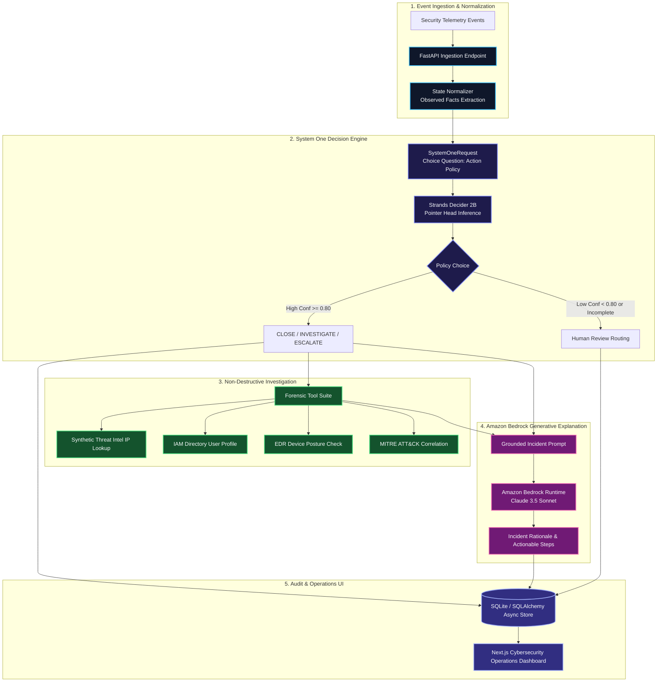
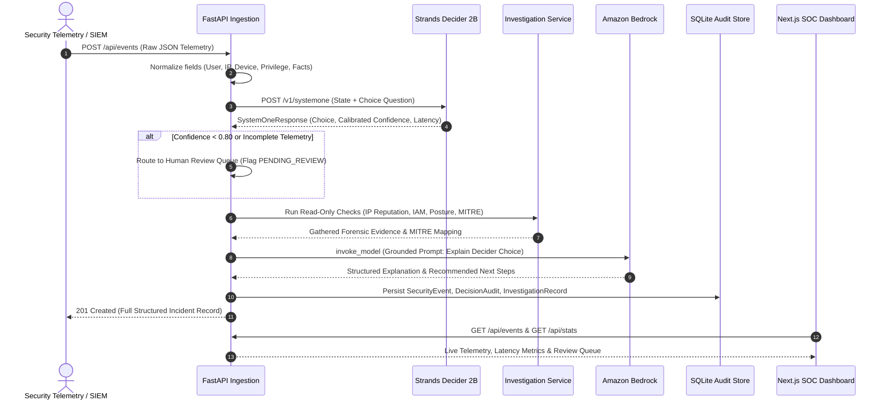

# SentinelFlow AI — System Architecture & Design Specification

## 1. Architectural Overview

SentinelFlow AI is an autonomous, policy-driven security triage agent designed for Security Operations Centers (SOC). It replaces conventional, expensive, and non-deterministic LLM loops with **Strands Decider 2B** — a specialized, 2-billion parameter "system one" decision model engineered specifically for low-latency classification, tool selection, and calibrated policy routing without free-form text hallucinations.

---

## 2. Sequence Workflow

---

## 3. Core Component Responsibilities

| Component | Responsibility | Technology |
|---|---|---|
| **Ingestion Engine** | Telemetry ingestion, schema validation, distinction between observed facts and inferences. | FastAPI, Pydantic V2 |
| **Decision Module** | Evaluates normalized state against organizational triage policy. Returns strictly constrained choices with calibrated probabilities. | Strands Decider 2B (`strands-decider`) |
| **Forensic Enrichment** | Enriches anomalous events with IP reputation, identity profile, and device posture without destructive side-effects. | Python Read-Only Tool Suite |
| **Generative Analysis** | Generates human-readable incident rationale and actionable containment steps strictly grounded in the Decider verdict. | Amazon Bedrock (`boto3`, `strands-agents`) |
| **Audit Ledger** | Preserves immutable audit trail of every model inference, latency metric, and analyst review action. | SQLite + SQLAlchemy Async |
| **Operations Dashboard** | Real-time SecOps console for monitoring triage streams, reviewing flagged cases, and viewing baseline benchmarks. | Next.js 15, TypeScript, Tailwind CSS, Recharts |
