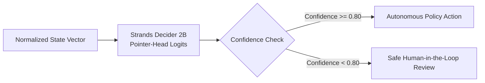

# Decision Pattern: Policy Classification with Strands Decider 2B

**Tags:** `#strands-decider-2b` `#policy`

---

## 1. Pattern Overview

**Policy Classification** is an autonomous agent decision pattern where an incoming structured or semi-structured state vector is deterministically mapped to one of a closed set of operational policies under strict compliance and risk criteria.

In high-velocity production systems (such as Security Operations Centers, financial risk engines, or content safety pipelines), agents must choose actionable outcomes with sub-second latency, zero syntactic hallucination, and rigorous confidence calibration.



---

## 2. Problem Statement: Why Conventional LLMs Fail at Policy Routing

Modern agent architectures frequently misapply general-purpose Large Language Models (LLMs) for discrete policy routing. In production SecOps, this introduces critical failure modes:

| Dimension | General-Purpose LLM (e.g., Claude, GPT-4) | Strands Decider 2B Specialized Decision Model |
| :--- | :--- | :--- |
| **Response Latency** | 1,500ms – 4,000ms per round-trip | **90ms – 180ms** (13.7x speedup) |
| **Output Space** | Open-ended freeform tokens (prone to JSON/markdown formatting drift) | **Closed pointer logit distribution** (0.0% formatting errors) |
| **Cost at Scale** | $0.003 – $0.015 per decision prompt | **Minimal local compute** (2B parameter inference) |
| **Calibration** | Poorly calibrated verbalized confidence | **Mathematical softmax probability** over discrete choices |
| **Failure Mode** | Hallucinates plausible but non-existent actions | **Routes to Human Review** on low confidence or missing facts |

---

## 3. Pattern Architecture & Implementation

### A. State Normalization (`backend/app/decision/policy.py`)
Before passing telemetry to the decider, heterogeneous telemetry events are sanitized into an unambiguous, observed-fact narrative:

```python
def format_event_for_decider(
    event_type: str,
    severity: str,
    username: str | None,
    source_ip: str | None,
    device: str | None,
    failed_login_count: int,
    privilege_level: str,
    event_description: str,
    raw_payload: dict,
) -> str:
    """Transform raw telemetry into a structured factual prompt."""
    return f"""SECURITY EVENT FOR POLICY CLASSIFICATION:
- Event Type: {event_type}
- Severity: {severity}
- User / Identity: {username or 'UNKNOWN'}
- Source IP: {source_ip or 'UNKNOWN'}
- Target Device / Host: {device or 'UNKNOWN'}
- Prior Failed Login Count: {failed_login_count}
- Privilege Context: {privilege_level}
- Telemetry Narrative: {event_description}
"""
```

### B. Discrete Choice Policy Definition
The policy is formulated as a `ChoiceQuestion` using the official `strands-agents` and `strands-decider` protocol:

```python
from strands_agents.types import ChoiceQuestion

POLICY_QUESTION = ChoiceQuestion(
    question="Based on the enterprise security policy, classify the required triage action for this security event:",
    choices=["CLOSE", "INVESTIGATE", "ESCALATE"],
    criteria=[
        "CLOSE: Event is routine, authorized, benign, or low-risk with verified normal telemetry (e.g., routine user login from known corporate device, standard scheduled maintenance, benign scanner traffic with zero impact).",
        "INVESTIGATE: Event has anomalous, suspicious, or ambiguous indicators requiring forensic enrichment before taking definitive action (e.g., failed logins followed by Tor IP success, unfamiliar geographic origin, anomalous user agent, off-hours access).",
        "ESCALATE: Event exhibits critical-risk or active compromise indicators demanding immediate human security analyst intervention (e.g., brute-force attack flooding, privilege escalation on domain controllers, unauthorized credential dumps, data exfiltration)."
    ]
)
```

### C. System One Pointer-Head Inference (`backend/app/decision/engine.py`)
The agent requests choice probabilities directly from the Strands Decider 2B HTTP service (`/v1/systemone`):

```python
request_payload = SystemOneRequest(
    model=self.model_name,
    prompt=state_text,
    question=POLICY_QUESTION,
    options={"temperature": 0.0}
)

response = await client.post(
    f"{self.server_url}/v1/systemone",
    json=request_payload.model_dump(),
)
s1_resp = SystemOneResponse.model_validate(response.json())
action = s1_resp.answer.choice  # "CLOSE" | "INVESTIGATE" | "ESCALATE"
confidence = s1_resp.answer.confidence  # Calibrated probability
```

---

## 4. Confidence Routing & Safe Fallback Guardrails

In autonomous cybersecurity, **a false negative or silent failure is unacceptable**. The Policy Classification pattern enforces two non-negotiable guardrails:

1. **Confidence Threshold (`CONFIDENCE_THRESHOLD = 0.80`)**:
   If the top choice logit probability is below 0.80, the agent flags the decision as `routed_to_human_review = True` and places it into the SecOps Analyst Pending Review queue.
2. **Missing Facts Guardrail**:
   If key forensic signals (e.g., source IP and target device) are missing from the telemetry stream, the system automatically marks the record as requiring human verification rather than guessing.
3. **No Destructive Automation**:
   Automated execution is strictly limited to non-destructive containment (enriching threat intel, gathering device posture, logging MITRE ATT&CK techniques). Irreversible actions (account termination, network isolation) require explicit human sign-off.

---

## 5. Division of Labor: Decider 2B vs Amazon Bedrock

SentinelFlow AI strictly decouples **verdict selection** from **incident reasoning**:

```
[Raw Alert] ──> [Strands Decider 2B] ──> [Deterministic Verdict (118ms)]
                       │
                       ▼
              [Synthetic Forensics]
                       │
                       ▼
            [Amazon Bedrock (Claude 3.5)] ──> [Incident Narrative & Remediation Steps]
```

- **Strands Decider 2B (System 1)**: Operates like an instinctive security reflex — low-latency, deterministic, highly focused on policy classification.
- **Amazon Bedrock (System 2)**: Operates like an expert analyst — synthesizes forensic findings, writes executive incident explanations, and suggests multi-step remediation playbooks.

---

## 6. Generalizability to Other Domains

The Policy Classification pattern is directly applicable across high-throughput enterprise domains:

1. **FinTech Fraud & Transaction Screening**:
   - Actions: `APPROVE`, `FLAG_2FA`, `FREEZE_TRANSFER`
   - Criteria: Velocity checks, geo-distance, device fingerprints.
2. **Content Moderation & Trust & Safety**:
   - Actions: `PUBLISH`, `QUEUE_MODERATOR`, `TAKEDOWN`
   - Criteria: Community guidelines violation confidence.
3. **Customer Support Routing**:
   - Actions: `AUTO_RESOLVE`, `TIER_1_AGENT`, `ENGINEERING_ESCALATE`
   - Criteria: Sentiment, customer tier, error severity.
